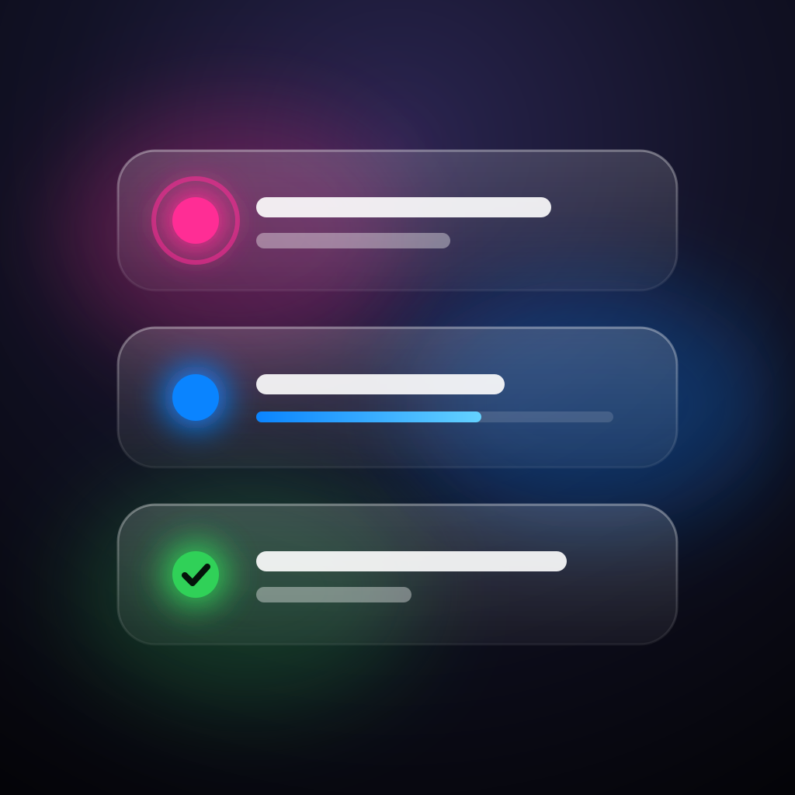
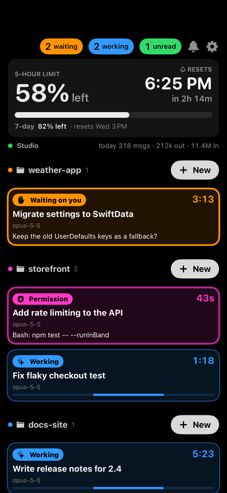

<p align="center">
  
</p>

<h1 align="center">Claude Companion</h1>

<p align="center">
  <b>A status board for your Claude Code sessions, on the iPhone sitting next to your Mac.</b><br>
  See what's working, what's done, and what's waiting on you, without switching windows.
  Answer permission prompts from across the room.
</p>

<p align="center">
  
  
  
  
</p>

<p align="center">
  
</p>

---

## Why

When several Claude Code sessions run at once, the expensive moments are the ones you miss: a session that finished
ten minutes ago, or one that has been sitting on a permission prompt while you were getting coffee. Claude Companion
puts every session on an always-on screen (an old iPhone on a charging stand works well) with color, sound, and a
couple of buttons, so nothing stalls unnoticed.

## Features

- **Live board.** One card per Claude Code session (desktop app and CLI), colored by status, with title, project,
  how long it has been in that state, and the latest turn recap.
- **Sounds and escalation.** Audio alerts when a session needs you or finishes, with adjustable volume. Waiting cards
  turn red after 5 minutes.
- **Allow / Deny from the phone.** Permission prompts in desktop sessions wait on the phone until you open that
  session on the Mac. CLI sessions are held for the phone while the Mac is idle.
- **Answer questions.** `AskUserQuestion` prompts show up on the phone with their options, plus a free-text
  "Other". When a desktop session's turn ends on a plain question, tap its card and type a short reply: it's sent as
  your next message (needs the Accessibility permission, like Interrupt). If Claude ended its turn with suggested
  answers, they show up as buttons.
- **Tap to open.** Tapping a card brings that session forward on the Mac. You can also start a new session in a recent
  project, or interrupt a running turn (Esc).
- **Usage at a glance.** Today's messages and tokens, plus plan usage and reset time. One tap adds a "resume work"
  reminder to Reminders.app for when your window refills.
- **Quiet when you want it.** Pin or mute sessions, do-not-disturb (all / pinned only), and a nightly quiet schedule.
- **Secure pairing.** Phones pair with a 6-digit code shown on the Mac. Only paired phones can connect, and you can
  revoke them all from the menu bar.
- **Menu-bar item.** `✳` on the Mac shows how many sessions are waiting on you.

## Status colors

| Color | Meaning |
|---|---|
| 🟣 Magenta, pulsing | Permission prompt pending |
| 🟠 Orange (🔴 after 5 min) | Waiting on you |
| 🔵 Blue, moving bar | Working |
| 🟢 Green | Turn done, not yet viewed on the Mac |
| 🔴 Red | Error |
| ⚪ Gray | Idle (collapsed section) |

## How it works

```
┌──────────────────────────── Mac ─────────────────────────────┐          ┌──── iPhone ────┐
│                                                              │          │                │
│  ~/.claude/sessions/<pid>.json ──┐                           │          │  SwiftUI board │
│  desktop app session metadata  ──┼──▶ claude-companiond ◀────┼── WS ───▶│  sounds, cards │
│  Claude Code hooks ──── HTTP ────┘    (LaunchAgent,          │  :47820  │  Allow / Deny  │
│    (127.0.0.1:47821)                   menu-bar item)        │ Bonjour  │                │
│                                            │                 │          └────────────────┘
│                                            └──▶ claude:// deep links, Esc keystroke
└──────────────────────────────────────────────────────────────┘
```

**`claude-companiond`** (Mac) is a small Swift daemon that runs as a LaunchAgent with a menu-bar item. It:

- reads `~/.claude/sessions/<pid>.json` for live busy / idle / waiting state,
- reads the Claude desktop app's session files for titles, unread state, and turn recaps,
- receives Claude Code hook events on `127.0.0.1:47821`,
- serves a WebSocket on port `47820`, advertised over Bonjour as `_claudecompanion._tcp`.

**The iOS app** (`ios/`) is SwiftUI. It finds the Mac over Bonjour (or a host you enter), pairs once, and then
reconnects on its own.

**The hook** (`hooks/companion-hook.sh`) forwards hook events to `claude-companiond`. It fails open: if the daemon isn't
running, it does nothing and Claude Code carries on as usual.

## Requirements

- macOS 14 or later, with [Claude Code](https://claude.com/claude-code) (desktop app and/or CLI)
- Xcode 15+ and [XcodeGen](https://github.com/yonaskolb/XcodeGen) (`brew install xcodegen`)
- `jq` (`brew install jq`), used by the hook installer
- An iPhone or iPad on iOS 17+, on the same network as the Mac

## Install

**1. Build and start the daemon**

```bash
scripts/install-daemon.sh
```

This builds `claude-companiond` in release mode, installs it under `~/Library/Application Support/ClaudeCompanion/`, and
loads it as a LaunchAgent. Re-run it after pulling changes. Logs go to `~/Library/Logs/ClaudeCompanion.log`.

**2. Install the Claude Code hook**

```bash
scripts/install-hooks.sh
```

This adds the hook to `~/.claude/settings.json` next to any hooks you already have, and backs up the file first. It is
safe to run more than once.

**3. Build the iOS app**

```bash
cd ios && xcodegen generate && open ClaudeCompanion.xcodeproj
```

Before building, set your own signing team and bundle ID: edit `DEVELOPMENT_TEAM` and `bundleIdPrefix` /
`PRODUCT_BUNDLE_IDENTIFIER` in [`ios/project.yml`](ios/project.yml), or change them in Xcode's Signing & Capabilities
tab. Then run it on your device.

**4. Pair**

On first launch the phone finds the Mac. Tap **Show code on Mac**, then type the 6-digit code from the macOS
notification (it's also shown in the menu bar). That's it.

**5. (Optional) Allow Interrupt**

**Interrupt (Esc)** presses Esc in Claude to stop a running turn, and replies from the phone are pasted into the
session's message box. Both are typed by `claude-companion-keys`, a small helper that runs next to the daemon and asks
macOS for Accessibility access at launch; turn it on under **System Settings → Privacy & Security → Device Control and Data Access** (**Accessibility** on older macOS).
The installer only replaces the helper when its code changes, so daemon updates keep the grant.

## Permission prompts from the phone

The `PermissionRequest` hook asks `claude-companiond` what to do.

**Desktop sessions** go to the phone first, even while you're at the Mac: the phone shows **Allow / Deny** (or the
question's options). The prompt moves to the desktop as soon as you open that session in Claude (or are using Claude
with it already on screen), or after 9.5 minutes.

**CLI sessions** have no way to tell which one you're looking at, so they use an idle rule:

- If you've used the Mac's keyboard or mouse in the last 60 seconds, it answers "no decision" right away. The normal
  prompt appears and the phone just displays it.
- If you haven't, the hook is held and the phone shows **Allow / Deny**. It falls back to the normal prompt as soon as
  you touch the Mac, or after 9.5 minutes.

To change the 60 seconds, set `COMPANION_AWAY_SECONDS` in the LaunchAgent's environment.

> Interrupt sends Esc rather than SIGINT on purpose: desktop sessions run the CLI in stream-json mode, where SIGINT
> ends the process outright.

## Uninstall

```bash
scripts/install-hooks.sh --remove
```

```bash
scripts/install-daemon.sh --remove
```

Then delete the app from your phone. To unpair phones without uninstalling, use **Unpair all phones** in the menu bar.

## Debugging

```bash
swift run claude-companiond --dump
```

prints the current snapshot (the same JSON the phone receives) and exits. For headless simulator runs, launch the app
with `-debugToken <token>` to skip pairing, or with `-demo YES` to show made-up sessions without a Mac (Debug builds
only; that's how the screenshot above was made).

## Project layout

```
Sources/
  CompanionShared/    Wire protocol and models shared by Mac and iOS
  claude-companiond/  Mac daemon: session store, hook server, phone server, usage, menu bar
ios/
  ClaudeCompanion/    SwiftUI app
  project.yml         XcodeGen spec
hooks/                Claude Code hook script
scripts/              Install / uninstall for the daemon and hooks
```

## Limitations

- Only Claude Code sessions are shown. Regular claude.ai chats have no local status feed.
- The phone and Mac need to be on the same local network.
- Session metadata comes from Claude's local files, which aren't a public API and may change between releases.

## License

[MIT](LICENSE)

---

<sub>Not affiliated with or endorsed by Anthropic. "Claude" is a trademark of Anthropic.</sub>
